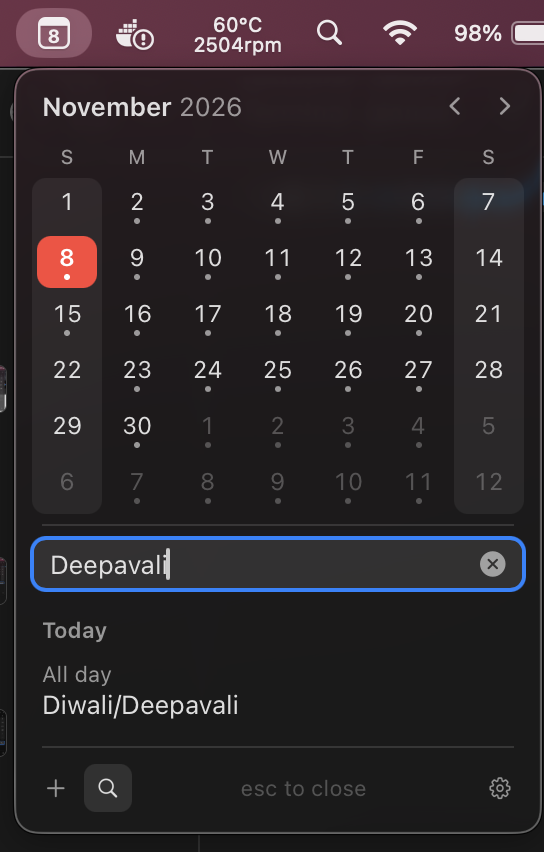
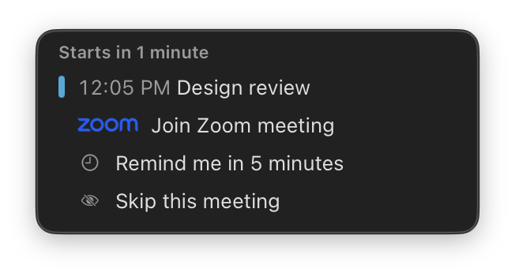

#  Glance

A month calendar in the macOS menu bar. No account, no main window, and
nothing leaves this Mac.

[](https://github.com/zshanansari/glance/actions/workflows/ci.yml)
[](https://github.com/zshanansari/glance/releases/latest)
[](LICENSE)


Apple Silicon Macs on macOS 13 or newer. Intel Macs can build it from source.

<p align="center">
  
  &nbsp;&nbsp;
  
</p>

- [Features](#features)
- [Install](#install)
- [Permissions and privacy](#permissions-and-privacy)
- [Keyboard shortcuts](#keyboard-shortcuts)
- [Settings](#settings)
- [Quick add](#quick-add)
- [Troubleshooting](#troubleshooting)
- [How it works](#how-it-works)
- [Release notes](#release-notes)
- [Contributing](#contributing) · [Security](#security) · [Credits](#credits) · [License](#license)

## Features

- **This month, next to the clock.** Click the date for the month, with a dot
  under every day that has events. Pick a day to see its events, open one in
  Calendar, or join a meeting from it. Tick a reminder's circle to mark it
  done in Reminders, with Undo right after. Today's finished meetings fold into
  an “N earlier” line, and declined ones are struck through. Optionally, the
  list runs on into the coming days.
- **Add an event in your own words.** Press **⌘N** or the + in the footer and
  type “Lunch with Sam tomorrow 1pm at Blue Tokai”. Glance shows what it
  understood as you type, adds the event to the calendar you chose, and offers
  Undo for 30 seconds. Record a chord in Settings → General to start one from
  any app. The phrases it reads are under [Quick add](#quick-add).
- **Find any event.** **⌘F** or the search icon looks through your events by
  title and place, from a month back to three months ahead, upcoming first.
  Return opens the first result's day.
- **Feels like part of macOS.** The popover opens and closes like a system
  menu, in the system font and colors, and follows light and dark. Today and
  the day you pick take red, your accent, or any of the system colors.
  Settings is laid out like System Settings, with SF Symbols.
- **Your language and region.** Dates and the 12- or 24-hour clock follow
  System Settings → Language & Region. A new install also starts the week on
  your region's first day, and week numbers count the ISO way or the US way.
- **What’s next.** Optionally, the menu bar item counts down to the next
  calendar event or scheduled reminder after the date, as in “• in 25m”. A
  meeting about to start takes over from a long block still running, and the
  day’s list marks the same meeting. Done with one early? Stop its countdown
  from the list.
- **A second time zone.** Pick a city, and each event in the day list also
  shows its start there. Optionally, the menu bar shows that city's time too,
  as in “• NY 11:17 AM”.
- **Never late to a call.** A minute before a meeting with a link starts, a
  small card under the menu bar item offers Join, without taking focus.
  Snooze it for five minutes, skip the meeting, or press Escape to put it
  away. In-person meetings can get a card too, ten minutes ahead, with the
  place and a button that opens it in Maps.
- **Your calendars, your lists.** Settings → Events chooses which events the
  countdown counts and when it appears; Settings → Calendar chooses which
  calendars and reminder lists Glance reads at all.
- **Keyboard and VoiceOver.** The month, search, quick add, Settings and the
  reminder card work from the keyboard. VoiceOver reads the menu bar item as
  the full date and your next meeting, and Glance follows Increase Contrast.
- **Stays on this Mac.** Calendar and Reminders are read locally, and quick
  add reads dates with macOS’s own detector. Nothing is uploaded: the only
  thing that goes out is an event you choose to hand to Google Calendar, and
  Join only ever opens a link to a known meeting service.

The popover's footer holds new event, search and settings; point at one to see
its shortcut. Right-click the menu bar item for Settings and Quit, and, while
a meeting with a link is on or still to come today, **Join** it from the top of
that menu. **⌃⌘K** shows or hides the calendar from any app, and Settings →
General can record chords for joining the next meeting and for a new event.

<p align="center">
  
  <br>
  <sub>⌘F searches by title and place, upcoming first.</sub>
</p>

<p align="center">
  
  <br>
  <sub>The menu bar item counting down to the next meeting.</sub>
</p>

<p align="center">
  
  <br>
  <sub>A minute before a call, the card offers Join without taking focus.</sub>
</p>

## Install

Download the disk image from
[Releases](https://github.com/zshanansari/glance/releases/latest) and drag
Glance to Applications.

Releases are not notarized yet, so the first launch needs a right-click on
Glance in Applications, then **Open**. After that it opens normally. On the
first launch, Settings opens on a welcome page that asks for Calendar access,
offers launch at login and the countdown, and shows the shortcut that opens
the calendar from anywhere.

To build from source:

```bash
pnpm install --frozen-lockfile
pnpm build
pnpm dmg
```

Then open the disk image in `src-tauri/target/release/bundle/dmg` and drag
Glance to Applications. See [Building](docs/building.md) for the toolchain
and [Releasing](docs/release.md) to ship.

### Update

Installed copies update themselves from Settings → About, which also says
when Glance last checked and what’s new in a waiting release. Glance checks
GitHub shortly after launch and every twelve hours after that. Automatic
updates are on by default, and an automatic install waits until the calendar,
the reminder card and Settings are all closed, so a relaunch never cuts off
an event you are typing. Switched off, Glance still checks and puts a dot on
its menu bar icon when a release is ready, with **Update and Restart** in the
menu bar item's menu. Checking by hand always asks before it installs.

<p align="center">
  
  <br>
  <sub>Settings → About: the version, Check for Updates, and what’s new in a waiting release.</sub>
</p>

### Uninstall

Turn off *Launch at login* in Settings → General if it is on, so the login
item goes with the app. Then quit Glance and drag it from Applications to the
Trash. To forget its settings as well, remove
`~/Library/Application Support/Glance`.

## Permissions and privacy

Glance asks for at most three things, and works with none of them granted.

| Permission | What it is for | If you say no |
| --- | --- | --- |
| **Calendar** | Reading your events for the month's dots, the day list, search, the countdown and the reminder card, and adding the events you quick add. macOS words the prompt as “Glance uses your calendars to show your next meeting in the menu bar.” | The month still opens and the day list offers **Allow Calendar Access…**. Allow it later there, in Settings → Calendar, or under System Settings → Privacy & Security → Calendars. |
| **Reminders** | Showing scheduled reminders beside your events and in the countdown, and marking one done when you tick it off. Asked right after Calendar access is granted, and again from **Allow Access…** under Reminders in Settings → Calendar. | Only reminders are missing. Events are unaffected. |
| **Accessibility** | Only the system-wide chords: show or hide the calendar, join the upcoming meeting, and start a new event. macOS may ask the first time one fires. The popover's own keys and the click-outside-to-close need no grant. | The chord does nothing until Glance is allowed under System Settings → Privacy & Security → Accessibility. Everything else works. |

Glance asks for nothing else: no Automation, no notifications, no files.

**What it keeps.** Settings are one JSON file at
`~/Library/Application Support/Glance/settings.json`, written readable by your
account only. Countdowns you stopped are in `dismissed.json` beside it, and
forgotten once their events end. A snoozed reminder lives in the reminder
card's own web storage, so it survives a restart. Nothing is logged or
reported.

**What goes out.** Glance makes one kind of connection itself: the update
check, which fetches `latest.json` from this repository's Releases on GitHub
and, when a release is ready and you allow it, the signed update payload.
Everything else that reaches the network is a page you open yourself, in your
browser: a meeting you join, a place you open in Maps, an event you hand to
Google Calendar from quick add, and the links in Settings → About.

## Keyboard shortcuts

| Where | Keys | What it does |
| --- | --- | --- |
| Anywhere | **⌃⌘K** | Shows or hides the calendar. Change or clear it in Settings → General. |
| Anywhere | *your chord* | Joins the meeting under way, or your next one today. Record it in Settings → General; there is none until you do. |
| Anywhere | *your chord* | Opens the calendar straight into quick add. Record it in Settings → General as *New event*; there is none until you do. |
| Calendar | **⌘N** | New event. Return adds it; Escape closes the field. |
| Calendar | **⌘F** | Search. ↓ moves to the results and ↑ ↓ walk them; Return opens the first result's day. |
| Calendar | **⌘,** | Opens Settings. |
| Calendar | **← → ↑ ↓** | Moves a day, or a week, through the month. |
| Calendar | **Page Up**, **Page Down** | The previous or next month. |
| Calendar | **Home**, **End** | The first or last day of the month. |
| Calendar | **T** | Back to today. |
| Calendar | **Escape** | Closes quick add, then search, then the popover. |
| Menu bar item | **⌘,** **⌘Q** | Settings… and Quit Glance, in the right-click menu, with Join at the top while a meeting with a link is on or next today. |
| Settings | **↑ ↓**, **Home**, **End** | Moves through the panes in the sidebar. ← and → work too. |
| Settings | **← → ↑ ↓** | Chooses a menu bar style or a color in those pickers. |
| Settings | **Escape** | Stops recording a chord without changing it. |
| Reminder card | **Return** | Joins the meeting. |
| Reminder card | **Escape** | Puts the card away. The meeting keeps counting down. |

## Settings

**General.** *Launch at login* keeps Glance in the menu bar after a restart.
*Hourly chime* sounds once an hour, softly, with a button to preview it.
*Install updates automatically* installs a release when one is found; off, the
menu bar icon shows a dot instead. Under *Shortcuts*, *Show or hide the
calendar* holds ⌃⌘K, and *Join upcoming meeting* and *New event* are empty
until you record a chord. Click a field, press the keys, and **Clear** removes
it. No two of them can share a chord.

**Appearance.** *Menu bar* picks one of four styles, *Calendar with date*,
*Dotted calendar*, *Cutout date* and *Date only*, and *Show day of week* and
*Show month* add those to the date. *Appearance* under *Theme* is *Match
System*, *Light* or *Dark*.

**Calendar.** Under *Month*: *First day of the week*; *Week numbers* along the
left edge, counted the *ISO 8601* or *US* way under *Count weeks*; *Coming
days*, from *Off* to *1 week*, for meetings on the next few days under
today's; *Today and selection*, the color that marks today and the day you
pick, as *Accent Color*, *Blue*, *Purple*, *Pink*, *Red*, *Orange*, *Yellow*,
*Green* or *Graphite*; and *Highlight*, which shades the columns of the days
you choose. Under *Second time zone*, *Time zone* is *Off* or a city, and *Show
in the menu bar* adds its time after the date. *Calendars* and *Reminders* ask
for access with **Allow Access…**, then list every calendar and reminder list
with a switch each. A calendar you turn off leaves all of Glance: the month,
the countdown and the meeting reminder.

**Events.** Under *Menu bar countdown*, *Count down to the next event* puts
“• in 25m” after the date; *When it appears* runs from *At start of event*
through *15 minutes before* to *24 hours before*, or *Always*; *Look ahead*,
from *Today* to *1 month*, is how far *Always* looks for the next event;
*Event time* shows when it starts until it does; *Event title* adds the name,
shortened to fit. *Count these events* has *Events without participants* and
*Events without conferencing or location*, for blocks nobody else was invited
to and items with no link or place. Under *Meeting reminder*, *Remind before
meetings* shows the card a minute before a call, and *In-person meetings too*
adds a card ten minutes before a meeting with a place and no link. Under
*Quick add*, *Add events to* is the *Default calendar* or one of yours, and
*Your meeting link* is the Zoom, Meet or Teams room that “on zoom” or “on
meet” attaches.

<p align="center">
  
  <br>
  <sub>Settings → Events: the countdown, the meeting reminder, and quick add.</sub>
</p>

**About.** The version, **Check for Updates** with when Glance last checked,
*What’s new* for a waiting release, and links to the release notes, the
issue tracker and the source. An update that is ready also shows at the foot
of the sidebar, with **Restart to update**.

## Quick add

Press **⌘N** or the + in the footer and type the event as you would say it.
macOS's date detector finds the day and time; Glance reads the rest. A preview
shows what it understood before you press Return.

| You type | Glance makes |
| --- | --- |
| `Lunch with Sam tomorrow 1pm` | “Lunch with Sam”, tomorrow at 1:00 PM, for an hour. |
| `Dentist 24 Dec` | An all-day event, with no time given. |
| `Standup 9am` | Today at 9:00 AM, or tomorrow once 9:00 AM has passed. |
| `Review 2 to 3:30pm` | A range sets the end. |
| `Call tomorrow 4pm for 30m` | Thirty minutes long. `for an hour`, `for 2 hours` and `for half an hour` work the same way. |
| `Coffee Friday 10am at Blue Tokai` | The place after “at” or “@”, when it starts with a capital letter or a digit, so “Look at designs” stays a title. |
| `Sync Monday 11am on zoom` | Your meeting link from Settings → Events attached, with `on teams`, `via meet` or `google meet` too. |
| `Sync Monday 11am on meet` with no link of your own | Return opens the event in Google Calendar in your browser, which makes the Meet link. |
| `Planning Tue 2pm sam@example.com` | Return opens the event in Google Calendar, which sends the invitations. Up to twenty addresses. |

What is left after the date, length, place, call and guests becomes the
title, or “New Event” with nothing left. Events go to the calendar under *Add
events to* in Settings → Events, and **Undo** stays beside the day for 30
seconds.

## Troubleshooting

**“Glance can’t be opened” on the first launch.** Releases are not notarized.
Right-click Glance in Applications, choose **Open**, then **Open** again in the
dialog. Later launches need nothing.

**Calendar asks for access again after an update.** macOS ties the grant to
the app's signature. Every release is signed with the same certificate, so
this happens only if a release had to be signed differently. Allow it once in
the day list or Settings → Calendar and it stays.

**The join chord asks for Accessibility.** macOS needs Glance allowed under
System Settings → Privacy & Security → Accessibility before it will deliver a
system-wide chord. If macOS refuses the chord, Settings says so under the field
and keeps the chord that worked before, rather than claiming one that does
nothing. Allow Glance, then record the chord again.

**Check for Updates sits on “Checking…”.** Glance gives each of GitHub's
addresses two seconds to answer, eight in all, so a check that hangs means
GitHub is not reachable from this network. Download the disk image from
[Releases](https://github.com/zshanansari/glance/releases/latest) instead.

**No events shown.** Check that Calendar access is allowed, in Settings →
Calendar or System Settings → Privacy & Security → Calendars, and that the
calendar is switched on under *Calendars* there: a calendar turned off leaves
the month, the countdown and the reminder alike. If the day list has events
but the countdown stays empty, *Look ahead* and *Count these events* in
Settings → Events say which ones it counts and how far ahead it looks.

## How it works

Glance is a [Tauri 2](https://tauri.app) app: a Rust host and three small web
windows, the month popover, the reminder card and Settings. Each window has
its own capability file in `src-tauri/capabilities`, so it can call only the
commands it needs, and the three share nothing else. The host reads Calendar
and Reminders through EventKit, with [objc2](https://github.com/madsmtm/objc2)
bindings, on the main thread, and hands the renderer plain data. The renderer
never sees a URL the host has not allowlisted: Join opens only an https link on
a known meeting host, such as Zoom, Google Meet, Microsoft Teams, Webex,
FaceTime, Jitsi or GoTo, and the host builds the Maps and Google Calendar
addresses itself.

Updates come from this repository's Releases. The host reads `latest.json`,
and the payload it downloads must verify against the public key compiled into
the app. That key has no rollover, so a release signed with any other key would
be refused by every installed copy. [Building](docs/building.md) covers the
toolchain, debug builds and why local builds need a stable signing identity;
[Releasing](docs/release.md) covers the notarized image, the update signing key
and what to upload.

## Release notes

Each release has its notes in [docs/release-notes](docs/release-notes), and the
[Releases](https://github.com/zshanansari/glance/releases) page carries the
same text with the downloads.

## Contributing

Issues and pull requests are welcome. [Contributing](CONTRIBUTING.md) has the
steps for a first pull request and what is in scope, and the
[code of conduct](CODE_OF_CONDUCT.md) applies throughout.

## Security

Report a vulnerability privately, as [Security](SECURITY.md) describes, rather
than in a public issue.

## Credits

Glance began as a fork of [Calendo](https://github.com/vipinsight/calendo) by
Vipin Yadav. The hourly chime, `beep.mp3`, is from
[Itsycal](https://github.com/sfsam/Itsycal) by Sanjay Madan. The marks on join
rows are the services' own logos, and the trademarks belong to Google, Zoom,
Microsoft, Cisco and Apple.

## License

MIT. See [LICENSE](LICENSE).
