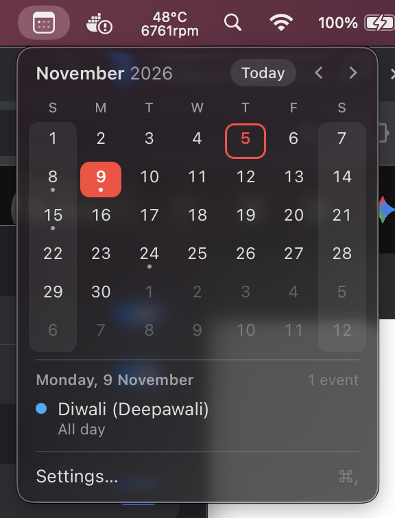
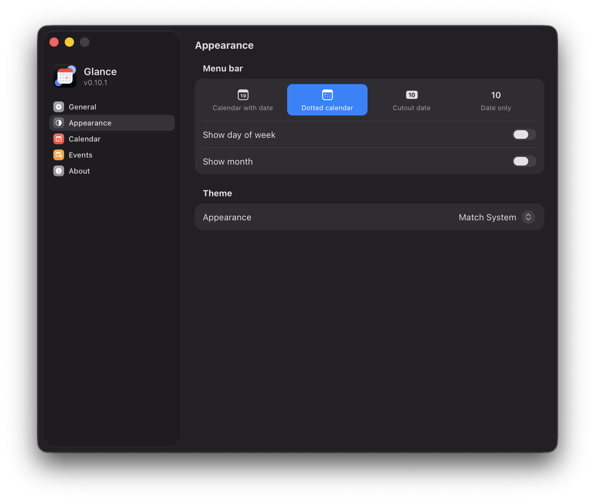
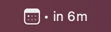
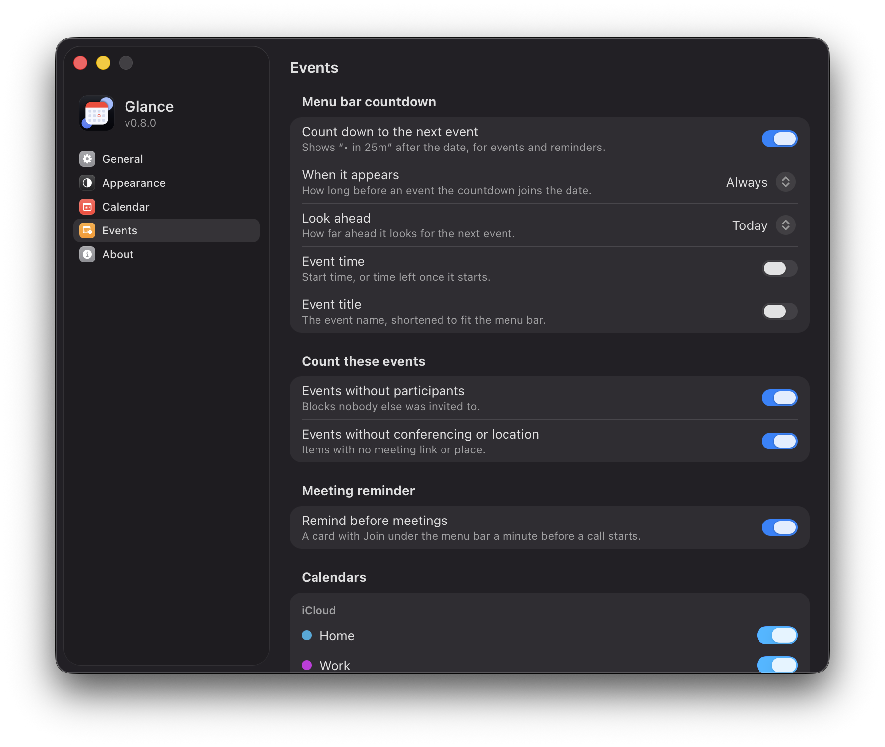
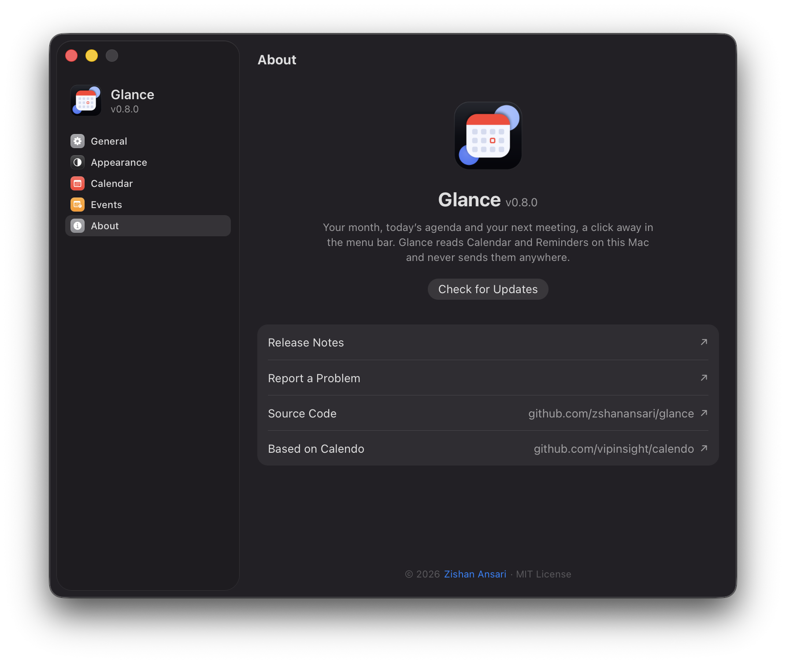

#  Glance

A month calendar in the macOS menu bar. No account, no main window, and
nothing leaves this Mac.

Apple Silicon Macs on macOS 13 or newer. Intel Macs can build it from source.

<p align="center">
  
  &nbsp;&nbsp;
  
</p>

## Features

- **This month, next to the clock.** Click the date for the month, with a dot
  under every day that has events. Pick a day to see its events, open one in
  Calendar, or join a meeting from it.
- **Feels like part of macOS.** The popover opens and closes like a system
  menu, in the system font and colors, and follows light and dark. Today and
  the day you pick take red, your accent, or any of the system colors.
  Settings is laid out like System Settings, with SF Symbols.
- **What’s next.** Optionally, the menu bar item counts down to the next
  calendar event or scheduled reminder after the date, as in “• in 25m”.
  Done with a meeting early? Stop its countdown from the day’s list.
- **Never late to a call.** A minute before a meeting with a link starts, a
  small card under the menu bar item offers Join, without taking focus.
- **Your calendars, your lists.** Settings → Events chooses the look-ahead,
  which events qualify, when the countdown appears, and which calendars and
  reminder lists it reads.
- **Stays on this Mac.** Calendar and Reminders are read locally. Nothing is
  uploaded, and Join only ever opens a link to a known meeting service.

Right-click the menu bar item for Settings and Quit. **⌘,** opens Settings.
**⌃⌘K** shows or hides the calendar from any app, and Settings → General can
record a chord for joining the next meeting. macOS may ask for Accessibility
the first time a system-wide shortcut fires.

## Screenshots

<p align="center">
  
</p>

<p align="center">
  
  &nbsp;
  
</p>

## Install

Download the disk image from
[Releases](https://github.com/zshanansari/glance/releases/latest) and drag
Glance to Applications.

Releases are not notarized yet, so the first launch needs a right-click on
Glance in Applications, then **Open**. After that it opens normally.

Installed copies can update themselves from Settings → About. Automatic
updates are on by default; switched off, Glance still checks and puts a dot on
its menu bar icon when a release is ready.

To build from source:

```bash
pnpm install --frozen-lockfile
pnpm build
pnpm dmg
```

Then open the disk image in `src-tauri/target/release/bundle/dmg` and drag
Glance to Applications. See [Building](docs/building.md) for the toolchain
and [Releasing](docs/release.md) to ship.

## Credits

Glance began as a fork of [Calendo](https://github.com/vipinsight/calendo) by
Vipin Yadav.

## License

MIT. See [LICENSE](LICENSE).
